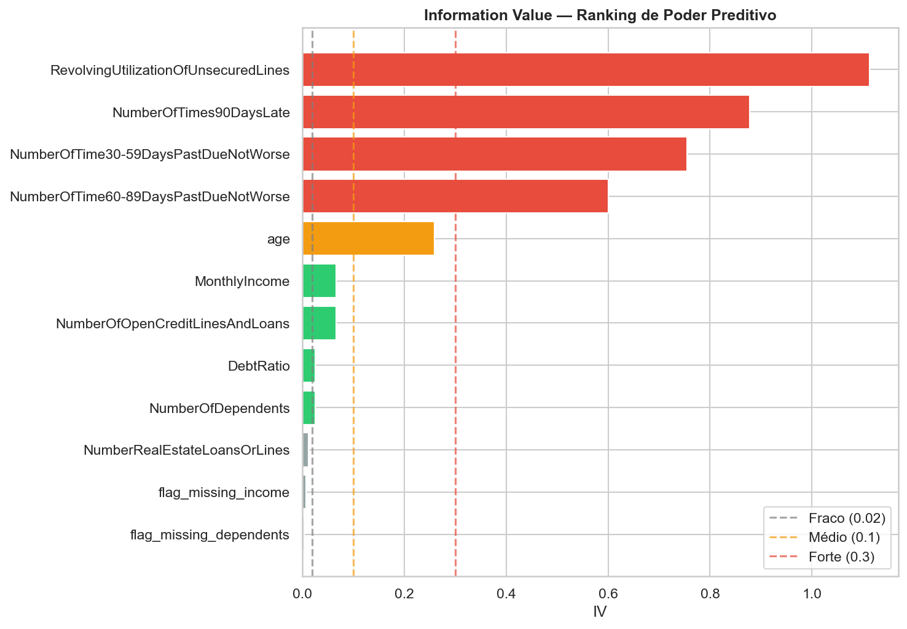
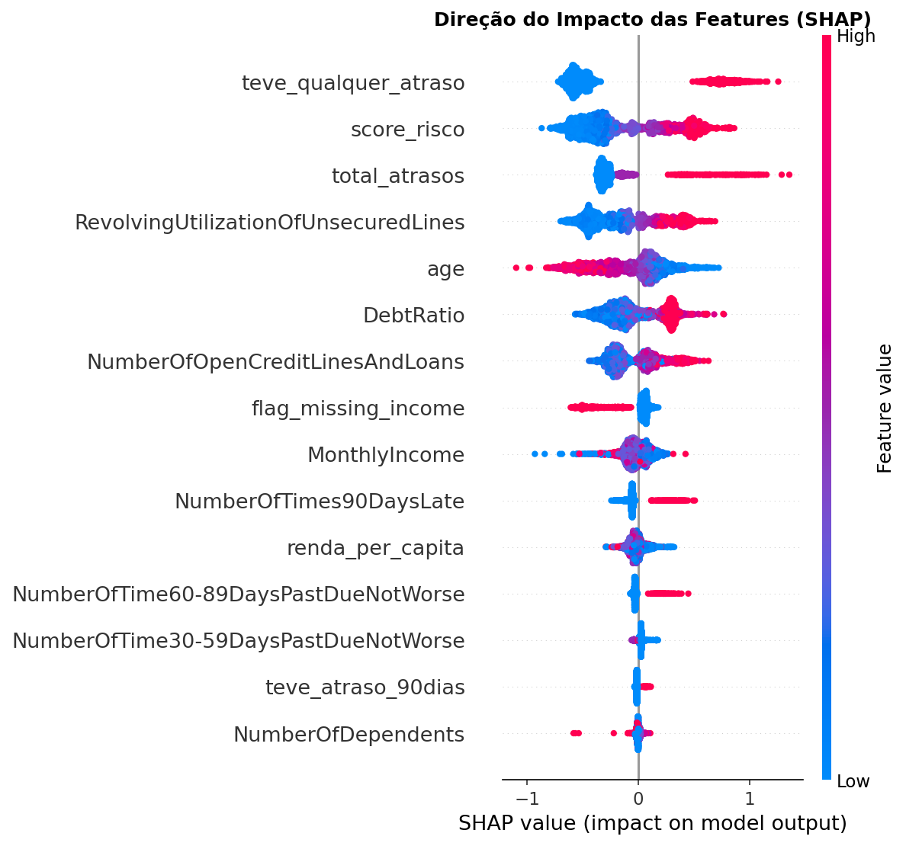
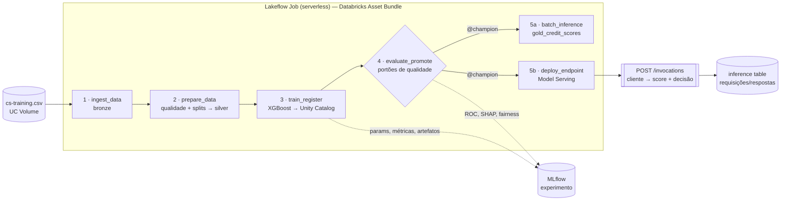

# Credit Scoring end-to-end no Databricks (MLOps)

Modelo de risco de crédito levado da **experimentação em notebooks** até **produção no Databricks**: dados versionados em
Delta (bronze → silver → gold), modelo registrado no **Unity Catalog** com rastreabilidade completa no **MLflow**,
portões de qualidade e fairness antes da promoção, **inferência em lote** e **endpoint em tempo real** — tudo
orquestrado por um **Lakeflow Job** e versionado como **Databricks Asset Bundle** (infraestrutura como código).

- **Problema:** prever a probabilidade de um cliente ficar 90+ dias inadimplente nos próximos 2 anos e decidir **aprovar ou reprovar** o crédito.
- **Dados:** [Give Me Some Credit (Kaggle)](https://www.kaggle.com/c/GiveMeSomeCredit) — 150 mil clientes, 10 variáveis, 6,7% de inadimplentes.
- **Modelo:** XGBoost com pré-processamento embutido, escolhido entre baseline, regressão logística e random forest.

## Resultados (conjunto de teste, 30 mil clientes nunca vistos)

| AUC | KS | Gini | Variação de AUC por idade | Variação de AUC por renda |
|---|---|---|---|---|
| **0,869** | **0,581** | 0,738 | 0,023 | 0,037 |

KS de 0,58, bem acima da referência de mercado (~0,40). Sem evidência de viés relevante por faixa etária ou de renda.

| Poder preditivo (IV) | Explicabilidade (SHAP) |
|---|---|
|  |  |

## Arquitetura



| Tarefa | O que faz |
|---|---|
| `ingest_data` | CSV do Volume → `bronze_credit` com schema explícito e metadados de linhagem |
| `prepare_data` | Validações de qualidade (falha rápido) → `silver_credit` com split estratificado train/val/test |
| `train_register` | Compara 4 modelos (runs no MLflow), treina o XGBoost escolhido, escolhe o threshold na validação e registra uma versão no Unity Catalog |
| `evaluate_promote` | Avalia a **versão registrada** no teste (métricas, SHAP, fairness, impacto financeiro). Só promove para `@champion` se passar nos portões |
| `batch_inference` | Pontua a carteira com o `@champion` → `gold_credit_scores` |
| `deploy_endpoint` | Cria/atualiza o endpoint sem downtime e faz uma consulta de teste |

## Da exploração à produção

A modelagem foi feita primeiro em notebooks ([notebooks/exploration](notebooks/exploration)), que ficam no repositório
**com as saídas** para documentar o raciocínio. Depois, a lógica foi industrializada em uma biblioteca testada
([src/credit_scoring](src/credit_scoring)) e em tarefas finas do job ([src/jobs](src/jobs)).

| Decisão tomada na exploração | Onde está em produção |
|---|---|
| Flags de missing antes da imputação; imputação pela mediana | [`features.py`](src/credit_scoring/features.py) — `CreditPreprocessor` |
| DebtRatio corrompido quando falta renda → winsorização no p99 do grupo plausível (< 2) | [`features.py`](src/credit_scoring/features.py) |
| Seleção de 15 features por Information Value | [`config.py`](src/credit_scoring/config.py) e [`iv.py`](src/credit_scoring/iv.py) |
| XGBoost com `scale_pos_weight` (AUC e estabilidade superiores) | [`modeling.py`](src/credit_scoring/modeling.py) |
| KS, threshold por F1, AUC por segmento, impacto financeiro | [`evaluation.py`](src/credit_scoring/evaluation.py) |

### O que mudou da exploração para a produção

1. **Leakage corrigido.** Medianas, percentis e limites de normalização eram calculados no dataset inteiro, antes do split.
   Agora o `CreditPreprocessor` (um transformer do scikit-learn) aprende tudo **só no treino**.
2. **Divergência entre treino e serving eliminada.** Na exploração, a inferência reimplementava o pré-processamento à mão
   (`predictor.py` + `pipeline_params.json`), e o `score_risco` era normalizado com limites diferentes do treino. Agora o
   pré-processamento, o modelo e o threshold são **um único artefato** no Unity Catalog: o endpoint recebe dados brutos.
3. **Threshold escolhido na validação**, não no teste — as métricas de teste deixam de ser otimistas.
4. **Códigos especiais 96/98** nas colunas de atraso (que não são contagens reais) passam a ser tratados.
5. **Avaliação do artefato registrado**, com portões automáticos (AUC, KS, fairness e não regressão contra o `@champion`).
6. **Saída de negócio no endpoint:** probabilidade, score 0–1000, decisão e os **motivos** (top-3 features que mais aumentaram
   o risco, via contribuições SHAP nativas do XGBoost) — importante para explicar uma recusa de crédito.

## Estrutura do repositório

```
├── databricks.yml                 ← bundle: variáveis, targets dev/prod, o que sincronizar
├── resources/
│   ├── credit_scoring.uc.yml      ← schema, Volume, modelo registrado, experimento MLflow
│   └── credit_scoring_pipeline.job.yml  ← Lakeflow Job: tarefas, dependências, ambiente
├── notebooks/exploration/         ← experimentação (EDA, features, modelagem, avaliação) — fora do job
├── src/
│   ├── credit_scoring/            ← biblioteca: config, data, features, iv, modeling, evaluation, serving
│   └── jobs/                      ← as 6 tarefas do job (notebooks finos e parametrizados)
├── tests/                         ← testes unitários + smoke test com o dataset real
├── scripts/query_endpoint.py      ← consulta o endpoint com um cliente
└── docs/img/                      ← gráficos da exploração
```

## Como reproduzir

### 1. Pré-requisitos
- Workspace Databricks com Unity Catalog e serverless (funciona no [Free Edition](https://www.databricks.com/learn/free-edition))
- O `cs-training.csv` baixado do [Kaggle](https://www.kaggle.com/c/GiveMeSomeCredit/data). O arquivo **não** está no repositório (as regras da competição não permitem redistribuir)

### 2. Trazer o repositório para o Databricks
*Workspace → Create → Git folder* → URL deste repositório.

O catálogo padrão é `workspace` (padrão do Free Edition). Se o seu for outro, altere `catalog` em [databricks.yml](databricks.yml).

### 3. Deploy
Abra o `databricks.yml` dentro do Git folder → painel **Deployments** → target `dev` → **Deploy**.
Isso cria o schema `credit_scoring_dev`, o Volume `raw_data`, o modelo registrado, o experimento e o job.

Alternativa pela [Databricks CLI](https://docs.databricks.com/aws/en/dev-tools/cli/install):
```bash
databricks bundle validate -t dev
databricks bundle deploy -t dev
```

### 4. Enviar o dataset para o Volume
*Catalog → workspace → credit_scoring_dev → Volumes → raw_data → Upload to this volume* → `cs-training.csv`.

Ou: `databricks fs cp cs-training.csv dbfs:/Volumes/workspace/credit_scoring_dev/raw_data/`

### 5. Rodar o pipeline
No painel **Deployments**, clique em **Run** ao lado de `credit_scoring_pipeline` — ou
*Jobs & Pipelines → [dev] credit-scoring-pipeline → Run now*, ou `databricks bundle run credit_scoring_pipeline -t dev`.

Não há agendamento: o job roda sob demanda. Para rodar de novo só as tarefas que falharam: *Repair run*.

### 6. Consultar o endpoint
```bash
pip install databricks-sdk
python scripts/query_endpoint.py --profile <seu-profile> --endpoint credit-scoring-dev
```
Resposta para o cliente de exemplo do script (utilização do rotativo de 95%, atrasos de 30 e 90 dias, renda baixa):
```json
{"prob_inadimplencia": 0.9128, "score": 87, "decisao": "REPROVAR",
 "motivos": "[\"teve_qualquer_atraso\", \"total_atrasos\", \"score_risco\"]"}
```
Pela interface: *Serving → credit-scoring-dev → Query endpoint*. O endpoint escala a zero; a primeira chamada depois
de um tempo parado leva alguns minutos.

### 7. Limpeza
```bash
databricks serving-endpoints delete credit-scoring-dev
databricks bundle destroy -t dev
```

### Configuração

| Variável | Padrão | Descrição |
|---|---|---|
| `catalog` | `workspace` | Catálogo existente onde o schema é criado |
| `schema` | `credit_scoring_dev` / `credit_scoring_prod` | Schema de tabelas, Volume e modelo |
| `min_auc` | `0.85` | Portão: AUC mínima no teste |
| `min_ks` | `0.40` | Portão: KS mínimo no teste |
| `max_fairness_gap` | `0.05` | Portão: variação máxima de AUC entre faixas de idade/renda |
| `endpoint_name` | `credit-scoring-dev` | Nome do endpoint |

O job também aceita `enable_inference_table=false`, caso o workspace não suporte inference tables.

## O que o pipeline cria

| Artefato | Tipo | Conteúdo |
|---|---|---|
| `bronze_credit` | Delta | Dados brutos + `_source_file`, `_ingested_at` |
| `silver_credit` | Delta | Dados validados + `split` (train/val/test) |
| `gold_credit_scores` | Delta | `id`, `prob_inadimplencia`, `score`, `decisao`, `motivos`, `inadimplente_real`, `model_version`, `scored_at` |
| `credit_scoring_xgb` | Modelo no UC | Uma versão por execução; alias `@champion`; tags com métricas de teste; descrição com model card |
| `credit_scoring_dev` | Experimento MLflow | Comparação dos 4 modelos, parâmetros, métricas, ROC, matriz de confusão, SHAP, AUC por segmento |
| `credit-scoring-dev` | Endpoint | CPU, scale-to-zero, servindo o `@champion` |
| `credit_endpoint_payload` | Delta | Log de requisições e respostas do endpoint |

## Testes locais

```bash
python -m venv .venv
.venv/Scripts/pip install -r requirements-dev.txt     # Linux/macOS: .venv/bin/pip
.venv/Scripts/python -m pytest -q
```
Com o `cs-training.csv` em `data/raw/`, o smoke test treina o modelo com os dados reais e verifica os portões de qualidade.
Sem o arquivo, ele é pulado.

Os testes cobrem: aprendizado só no treino, paridade entre um cliente e o lote (treino vs. serving), tratamento de nulos
e códigos 96/98, splits estratificados e determinísticos, portões de qualidade e o modelo logado no MLflow recebendo o
mesmo payload do endpoint.

## Limitações e próximos passos

- **Monitoramento:** drift das features e dos scores (PSI) com Lakehouse Monitoring sobre a `gold_credit_scores` e a inference table.
- **CI/CD:** GitHub Actions com `pytest` + `databricks bundle validate` a cada push e deploy em `prod` com service principal.
- **Retreino:** propositalmente fora do escopo — o modelo em produção é o escolhido na experimentação.
- **Premissas financeiras** (ticket médio, perda, receita) são ilustrativas.

## Créditos

Estrutura de MLOps inspirada em [cvision-mlops-dbx](https://github.com/RamVegiraju/cvision-mlops-dbx).
