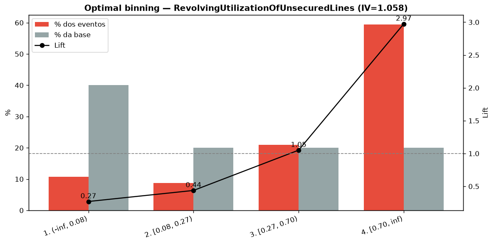
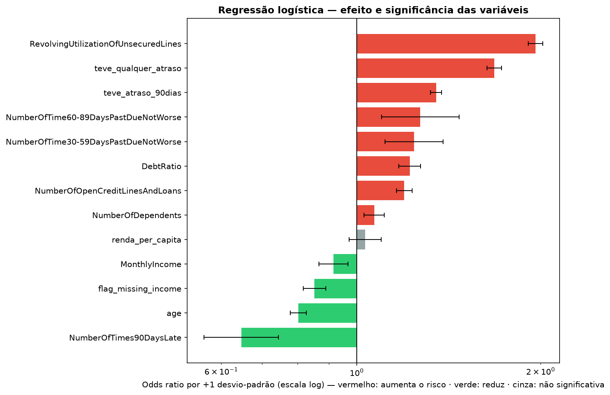
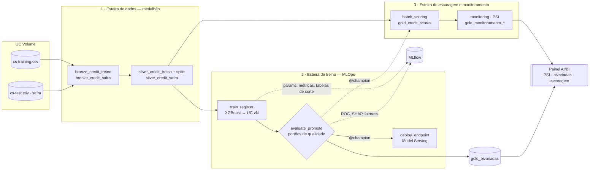

# Credit Scoring end-to-end no Databricks (MLOps)

Modelo de risco de crédito levado da **experimentação em notebooks** até **produção no Databricks**, organizado nas
três esteiras de um ciclo de vida de modelo em banco: **dados** (arquitetura medalhão em Delta), **treino** (MLflow +
Unity Catalog, portões de qualidade e fairness, endpoint em tempo real) e **escoragem e monitoramento** (safra
escorada com o `@champion` e estabilidade medida por PSI em um painel AI/BI). Tudo versionado como
**Databricks Asset Bundle** (infraestrutura como código).

- **Problema:** prever a probabilidade de um cliente ficar 90+ dias inadimplente nos próximos 2 anos e decidir **aprovar ou reprovar** o crédito.
- **Dados:** [Give Me Some Credit (Kaggle)](https://www.kaggle.com/c/GiveMeSomeCredit) — 150 mil clientes com desfecho para desenvolver o modelo e 101 mil sem desfecho, usados como **safra de produção**.
- **Modelo:** XGBoost com pré-processamento embutido, escolhido entre baseline, regressão logística e random forest.

## Resultados (teste: 30 mil clientes nunca vistos)

| AUC | KS | Gini | PR-AUC | Lift top 10% | Recall | Precisão | % reprovados |
|---|---|---|---|---|---|---|---|
| **0,869** | **0,581** | 0,738 | 0,400 *(base: 0,067)* | 5,6× | 70% | 27% | 17,5% |

- **KS de 0,58**, bem acima da referência de mercado (~0,40). Os 10% de maior risco concentram 5,6× a taxa média de inadimplência.
- **Threshold por regra de negócio:** o maior corte que captura pelo menos **70% dos inadimplentes** na validação
  (`min_recall`, configurável), escolhido com a tabela de cortes: fica próximo do corte de menor custo dos erros
  (premissas financeiras em `config.py`), reprovando 17,5% dos clientes.
- **Fairness:** a AUC varia 0,023 entre faixas etárias e 0,037 entre faixas de renda (portão: ≤ 0,05).
- **Estabilidade:** PSI do score de 0,0001 entre treino e safra — população estável.

| Poder preditivo por faixa (optimal binning) | Efeito e significância (regressão logística) |
|---|---|
|  |  |

## Arquitetura: três esteiras



Cada esteira é um **Lakeflow Job** separado porque tem um **ciclo de vida diferente** — o padrão de MLOps (dados,
treino e inferência em workflows distintos):

| Job | Quando roda | Tarefas | Produz |
|---|---|---|---|
| **1 · dados** | quando chega dado novo | `ingest_data` → `prepare_data` | bronze (bruto) → silver (validado, com splits) |
| **2 · treino** | só quando o modelo muda | `train_register` → `evaluate_promote` → `deploy_endpoint` | versão no UC, `@champion`, bivariadas, endpoint |
| **3 · escoragem** | a cada safra (ex.: mensal) | `batch_scoring` → `monitoring` | `gold_credit_scores`, PSI por feature e do score |
| **0 · ponta a ponta** | demonstração | chama 1 → 2 → 3 | tudo |

As esteiras se comunicam **pelas tabelas Delta e pelo alias `@champion`**, nunca por arquivos. A escoragem **não
retreina**: ela só consome o modelo promovido — escorar a safra do mês não cria uma versão nova do modelo.

## Da exploração à produção

A modelagem foi feita primeiro em notebooks ([notebooks/exploration](notebooks/exploration)), mantidos **com as
saídas** para documentar o raciocínio. Depois, a lógica foi industrializada em uma biblioteca testada
([src/credit_scoring](src/credit_scoring)) e em tarefas finas dos jobs ([src/jobs](src/jobs)).

| Decisão na exploração | Onde está em produção |
|---|---|
| Flags de missing antes da imputação; imputação pela mediana | [`features.py`](src/credit_scoring/features.py) — `CreditPreprocessor` |
| DebtRatio corrompido quando falta renda → winsorização no p99 do grupo plausível (< 2) | [`features.py`](src/credit_scoring/features.py) |
| Seleção de 15 features por **IV com optimal binning** | [`binning.py`](src/credit_scoring/binning.py), [`config.py`](src/credit_scoring/config.py) |
| Regressão logística com **p-valores** para a leitura de negócio | [03_modeling](notebooks/exploration/03_modeling.ipynb) |
| XGBoost com `scale_pos_weight` | [`modeling.py`](src/credit_scoring/modeling.py) |
| KS, **análise por 40 faixas e tabela de cortes**, AUC por segmento, impacto financeiro | [`evaluation.py`](src/credit_scoring/evaluation.py) |
| **PSI** treino × produção | [`monitoring.py`](src/credit_scoring/monitoring.py) |

### O que mudou da exploração para a produção

1. **Leakage corrigido.** Medianas, percentis e limites de normalização eram calculados no dataset inteiro, antes do
   split. Agora o `CreditPreprocessor` (um transformer do scikit-learn) aprende tudo **só no treino**.
2. **Divergência entre treino e serving eliminada.** Na exploração, a inferência reimplementava o pré-processamento à
   mão, e o `score_risco` era normalizado com limites diferentes do treino. Agora pré-processamento, modelo e threshold
   são **um único artefato** no Unity Catalog: o endpoint e a escoragem recebem dados brutos.
3. **Códigos especiais 96/98** nas colunas de atraso passaram a ser tratados. O diagnóstico veio da regressão logística:
   eles aparecem nas **mesmas 269 linhas nas três colunas** e, sozinhos, elevam a correlação entre as contagens de
   ~0,2–0,3 para **0,98–0,99** — invertendo o sinal de um coeficiente.
4. **Threshold escolhido na validação, por uma regra de negócio explícita** (recall mínimo), não no teste.
5. **Avaliação do artefato registrado**, com portões automáticos (AUC, KS, fairness e não regressão contra o `@champion`).
6. **Saída de negócio no endpoint:** probabilidade, score 0–1000, decisão e os **motivos** (top-3 features que mais
   aumentaram o risco, via contribuições SHAP nativas do XGBoost) — importante para explicar uma recusa de crédito.

## Painel de monitoramento (AI/BI)

Declarado no bundle ([`dashboard.yml`](resources/dashboard.yml)) e lendo só as tabelas gold:

| Página | O que mostra |
|---|---|
| **Desempenho do modelo** | Indicadores do `@champion` no teste (AUC, KS, PR-AUC, recall, % reprovados), taxa de inadimplência pelas 40 faixas de risco, curva KS, **tabela de pontos de corte** (precisão, recall e custo de cada threshold, com o corte do modelo marcado) e histórico das versões avaliadas |
| **Distribuição das variáveis** | Filtro por variável, status em destaque (variável de maior PSI), legenda das faixas de PSI, top variáveis por PSI e a distribuição esperado × atual por faixa da variável selecionada |
| **Escoragem** | Clientes escorados, % reprovados, score médio, decisões e distribuição do score por decisão |
| **Bivariadas** | Filtro por variável, IV de todas as variáveis, taxa de inadimplência e lift por faixa e a tabela do optimal binning |

## Estrutura do repositório

```
├── databricks.yml                 ← bundle: variáveis, targets dev/prod, o que sincronizar
├── resources/
│   ├── credit_scoring.uc.yml      ← schema, Volume, modelo registrado, experimento MLflow
│   ├── jobs.yml                   ← as três esteiras + o orquestrador
│   └── dashboard.yml              ← painel AI/BI
├── notebooks/
│   ├── exploration/               ← experimentação (EDA, features, modelagem, avaliação) — fora dos jobs
│   └── toolkit/                   ← catálogo de funções de ML reutilizáveis (referência)
├── src/
│   ├── credit_scoring/            ← biblioteca: config, data, features, binning, iv, modeling, evaluation, monitoring, serving
│   ├── jobs/{dados,treino,escoragem}/  ← as tarefas de cada esteira (notebooks finos e parametrizados)
│   └── dashboards/                ← definição do painel
├── tests/                         ← testes unitários + smoke test com o dataset real
└── scripts/query_endpoint.py      ← consulta o endpoint com um cliente
```

## Como reproduzir

### 1. Pré-requisitos
- Workspace Databricks com Unity Catalog e serverless (funciona no [Free Edition](https://www.databricks.com/learn/free-edition))
- `cs-training.csv` e `cs-test.csv` baixados do [Kaggle](https://www.kaggle.com/c/GiveMeSomeCredit/data). Os arquivos
  **não** estão no repositório (as regras da competição não permitem redistribuir)

### 2. Trazer o repositório e fazer o deploy
*Workspace → Create → Git folder* → URL deste repositório. Abra o `databricks.yml` → painel **Deployments** → target
`dev` → **Deploy**. Isso cria o schema `credit_scoring_dev`, o Volume, o modelo registrado, o experimento, os quatro
jobs e o painel.

O catálogo padrão é `workspace` e o painel usa o warehouse `Serverless Starter Warehouse` (padrões do Free Edition).
Se os seus forem outros, altere em [databricks.yml](databricks.yml).

Alternativa pela [Databricks CLI](https://docs.databricks.com/aws/en/dev-tools/cli/install):
```bash
databricks bundle validate -t dev
databricks bundle deploy -t dev
```

### 3. Enviar os dados para o Volume
*Catalog → workspace → credit_scoring_dev → Volumes → raw_data → Upload to this volume* → `cs-training.csv` e `cs-test.csv`.

### 4. Rodar
*Jobs & Pipelines* → **`[dev] credit-scoring · 0 · ponta a ponta`** → **Run now** (roda as três esteiras em sequência).
No dia a dia, cada esteira roda sozinha — por exemplo, só a **3 · escoragem** para uma safra nova.

Não há agendamento nem retreino automático. Para rodar de novo só as tarefas que falharam: *Repair run*.

### 5. Consultar o endpoint
```bash
pip install databricks-sdk
python scripts/query_endpoint.py --profile <seu-profile> --endpoint credit-scoring-dev
```
Resposta para o cliente de exemplo do script (utilização do rotativo de 95%, atrasos de 30 e 90 dias, renda baixa):
```json
{"prob_inadimplencia": 0.9128, "score": 87, "decisao": "REPROVAR",
 "motivos": "[\"teve_qualquer_atraso\", \"total_atrasos\", \"score_risco\"]"}
```
Pela interface: *Serving → credit-scoring-dev → Query endpoint*. O endpoint escala a zero; a primeira chamada depois
de um tempo parado leva alguns minutos.

### 6. Limpeza
```bash
databricks serving-endpoints delete credit-scoring-dev
databricks bundle destroy -t dev
```

### Configuração

| Variável | Padrão | Descrição |
|---|---|---|
| `catalog` | `workspace` | Catálogo existente onde o schema é criado |
| `schema` | `credit_scoring_dev` / `credit_scoring_prod` | Schema de tabelas, Volume e modelo |
| `safra` | `202610` | Rótulo da safra escorada e monitorada |
| `min_recall` | `0.70` | Regra do threshold: fração mínima de inadimplentes capturados na validação |
| `min_auc` / `min_ks` | `0.85` / `0.40` | Portões de qualidade no teste |
| `max_fairness_gap` | `0.05` | Portão: variação máxima de AUC entre faixas de idade/renda |
| `endpoint_name` | `credit-scoring-dev` | Nome do endpoint |
| `enable_inference_table` | `false` | Log de requisições do endpoint (não suportado no Free Edition) |

## O que o pipeline cria

| Artefato | Camada / tipo | Conteúdo |
|---|---|---|
| `bronze_credit_treino`, `bronze_credit_safra` | bronze | Dados brutos + `_source_file`, `_ingested_at` |
| `silver_credit_treino` | silver | Dados validados + `split` (train/val/test) |
| `silver_credit_safra` | silver | Safra validada, pronta para escorar |
| `gold_credit_scores` | gold | `prob_inadimplencia`, `score`, `decisao`, `motivos` por cliente, safra e versão |
| `gold_bivariadas` | gold | Optimal binning das features por versão do modelo |
| `gold_monitoramento_psi`, `gold_monitoramento_resumo` | gold | PSI por faixa e por variável, safra e versão |
| `gold_desempenho_modelo`, `gold_desempenho_faixas`, `gold_desempenho_cortes` | gold | Métricas no teste e resultado dos portões, 40 faixas de risco e pontos de corte, por versão |
| `credit_scoring_xgb` | modelo no UC | Uma versão por treino; alias `@champion`; tags com métricas; model card |
| `credit_scoring_dev` | experimento MLflow | Comparação dos 4 modelos, tabelas de faixas e cortes, ROC, SHAP, fairness |
| `credit-scoring-dev` | endpoint | CPU, scale-to-zero, servindo o `@champion` |
| `[dev] Credit Scoring — monitoramento` | painel AI/BI | PSI, bivariadas e escoragem |

## Testes locais

```bash
python -m venv .venv
.venv/Scripts/pip install -r requirements-dev.txt     # Linux/macOS: .venv/bin/pip
.venv/Scripts/python -m pytest -q
```
Com os CSVs em `data/raw/`, o smoke test treina o modelo com os dados reais e verifica os portões de qualidade.

Os testes cobrem: aprendizado só no treino, paridade entre um cliente e o lote (treino × serving), nulos e códigos
96/98, splits estratificados e determinísticos, optimal binning (inclusive faixas raras), PSI detectando e não
detectando drift, tabelas de faixas e de cortes, a regra do threshold, os portões e o modelo logado no MLflow
recebendo o mesmo payload do endpoint (inteiros, decimais e nulos).

## Limitações e próximos passos

- **Validação out-of-time:** o dataset não tem datas, então o teste é um split aleatório estratificado. Com safras
  reais, o teste seria a safra mais recente (OOT).
- **PSI ≈ 0:** o Kaggle separou treino e teste aleatoriamente, então a "safra" tem a mesma população do treino. O
  monitoramento funciona (os testes mostram a detecção de drift), mas aqui não há drift a detectar.
- **Calibração:** o `scale_pos_weight` distorce as probabilidades; para precificação seria preciso calibrar.
- **Testes automáticos:** rodar os testes a cada mudança no repositório (integração contínua).
- **Retreino:** propositalmente fora do escopo — o modelo em produção é o escolhido na experimentação.

## Créditos

Estrutura de MLOps inspirada em [cvision-mlops-dbx](https://github.com/RamVegiraju/cvision-mlops-dbx).
